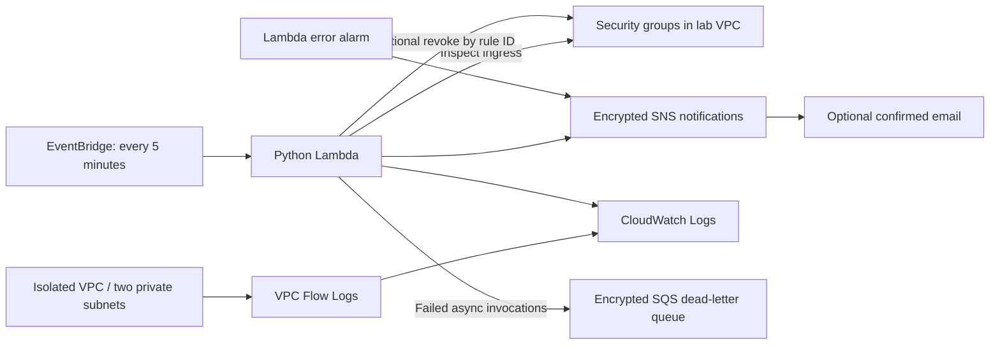

# AWS Terraform Security Automation

An AWS security lab built with **Terraform (HCL), Python, JSON, Git, and VPC**. Deploy an isolated network and continuously inspect its security groups for unrestricted access to administrative and database ports. Reporting is enabled by default; automatic remediation is an explicit opt-in.

## Architecture



The VPC has no internet gateway, NAT gateway, compute instances, or public IP assignment. Both its default and workload security groups start with no rules. Lambda runs outside the VPC so it can reach AWS APIs without NAT or VPC endpoints. EC2 read permissions require `Resource: "*"`; the code filters to the managed VPC, and optional revoke permission is constrained by the VPC ARN.

## What it detects

- Public IPv4 (`0.0.0.0/0`) or IPv6 (`::/0`) ingress.
- TCP or UDP access to SSH 22, RDP 3389, MySQL 3306, PostgreSQL 5432, Redis 6379, and MongoDB 27017; configurable in Terraform.
- Port ranges covering protected ports and all-protocol rules.
- Findings contain the group ID, rule ID, source CIDR, ports, and action status in structured JSON.

This is a focused lab, not a comprehensive posture scanner. It does not detect combinations of narrower public CIDRs, prefix lists, security-group references, IAM issues, or resources outside the managed VPC. It evaluates configured access even if routing currently prevents internet connectivity. Flow logs need actual network traffic to produce records.

## Try it locally

Requires Python 3.10+; local tests and the demo need no dependencies or AWS credentials.

```sh
python3 scripts/demo.py
python3 -m unittest discover -s tests -v
```

The demo reads `examples/security-group-rules.json` and reports the SSH and IPv6 RDP rules, leaving HTTPS unflagged. AWS Lambda supplies the boto3 SDK at runtime.

## Deploy to your AWS sandbox

Requires Terraform 1.6+ (below 2.0), AWS CLI, and authenticated credentials with permissions to create the resources declared in `infrastructure/`. Use an AWS sandbox account and a region with at least two available Availability Zones.

```sh
aws sts get-caller-identity
cp infrastructure/terraform.tfvars.example infrastructure/terraform.tfvars
# Edit terraform.tfvars; optionally set notification_email.
terraform -chdir=infrastructure init
terraform -chdir=infrastructure fmt -check
terraform -chdir=infrastructure validate
terraform -chdir=infrastructure plan -out=lab.tfplan
terraform -chdir=infrastructure apply lab.tfplan
```

Confirm the SNS email subscription if configured. Without a subscription, findings remain visible in Lambda's CloudWatch logs. After initialization, commit the generated `.terraform.lock.hcl` to pin provider selections. CI validates code without AWS credentials and never deploys. Terraform state is local by default and ignored by Git. For team use, configure an encrypted remote backend with locking before deployment; never commit state or credentials.

To invoke the audit immediately from a shell:

```sh
FUNCTION_NAME=$(terraform -chdir=infrastructure output -raw audit_function_name)
aws lambda invoke --function-name "$FUNCTION_NAME" --region ca-central-1 response.json
cat response.json
```

Use your configured region if different. An initially clean deployment should return `finding_count: 0`. To exercise the deployed scanner, add a temporary public SSH ingress rule to the **empty lab workload group** through the AWS console, invoke the function, inspect its logs and notification, then remove the test rule. Do not attach workloads to that group during the exercise.

## Enable remediation

Set `enable_remediation = true` in `terraform.tfvars`, then review and apply a fresh Terraform plan. This adds the revoke permission and switches Lambda into remediation mode. Any offending rule in this VPC may be removed, including manually created rules. A broad rule is deleted in full; it is not narrowed to preserve unprotected ports. Reapplying other Terraform configurations that manage unsafe rules can recreate them.

Scheduled scans are eventually consistent, not preventive controls. Findings repeat every five minutes while exposure persists; SNS/Lambda retries can also duplicate messages. A concurrent rule deletion is treated as success. Other AWS errors propagate to Lambda retries and ultimately the dead-letter queue. Findings are logged before notification, so logs remain the audit record if publishing fails; notifications are not a transactional remediation ledger. Monitor Lambda errors, EventBridge failed invocations, throttles, and the failure queue before relying on this in a production workflow. EventBridge delivery failures are separate from Lambda execution failures and are not covered by the Lambda dead-letter queue.

## Cost and cleanup

AWS usage can incur charges for KMS, logs, Lambda, SNS, SQS, and other services. There are no EC2 or NAT costs in this template. CloudWatch retention is 30 days and failed invocations are retained for 14 days. No resources are deployed by the local demo or tests.

```sh
terraform -chdir=infrastructure plan -destroy
terraform -chdir=infrastructure destroy
```

Destroy deletes the lab and its log groups; export evidence first if needed. KMS deletion is scheduled with a seven-day waiting period. Remove any manually attached resources that block VPC deletion.

## Repository

| Path | Purpose |
|---|---|
| `infrastructure/` | VPC, logging, IAM, Lambda, schedule, notifications, alarm |
| `automation/security_audit.py` | Detection, pagination, remediation, JSON findings |
| `tests/` | Offline behavioral tests using mock AWS clients |
| `examples/` | Sample JSON security rules |
| `scripts/demo.py` | Credential-free demonstration |
| `.github/workflows/validate.yml` | Python tests and Terraform formatting/validation |

## Design references

- [AWS VPC Flow Logs IAM role](https://docs.aws.amazon.com/vpc/latest/userguide/flow-logs-iam-role.html)
- [AWS security group rule API](https://docs.aws.amazon.com/AWSEC2/latest/APIReference/API_DescribeSecurityGroupRules.html)
- [AWS revoke ingress API](https://docs.aws.amazon.com/AWSEC2/latest/APIReference/API_RevokeSecurityGroupIngress.html)

## Portfolio description

Built a Terraform-based AWS security automation lab with isolated VPC subnets, flow logging, and a scheduled Python Lambda that detects public access to sensitive ports, generates JSON findings, and optionally remediates offending rules using VPC-scoped IAM permissions. Added offline behavioral tests and GitHub Actions validation.

This describes implemented functionality, not measured production outcomes. Deployment and live AWS verification must be completed in your account before claiming operational results.

## Local validation status

The offline demo and all 12 Python tests passed, as did `terraform fmt -check`. Provider installation was stopped because the AWS provider download was too slow to complete this local run, so Terraform schema validation and an AWS plan/apply have not been verified. Run `terraform init` and `terraform validate` before deployment; the CI workflow also runs these checks.
